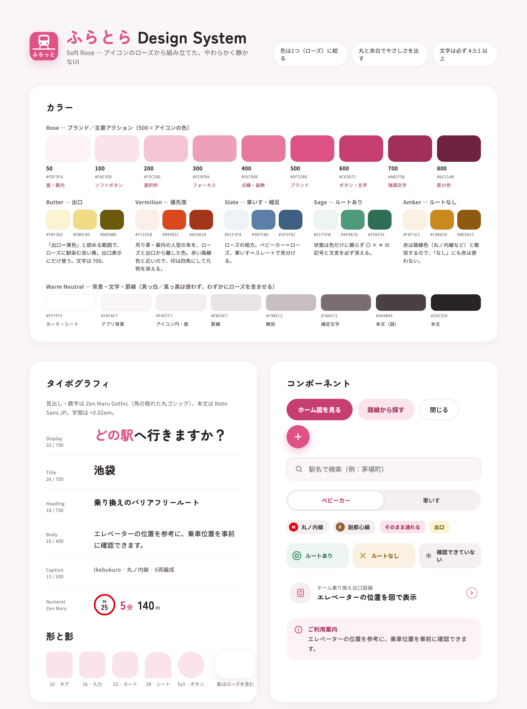

# ADR-0017: Web アプリの配色と書体を「Soft Rose」にし、トークンを Tailwind と Mantine の両方へ同じ値で渡す

- **ステータス**: Accepted
- **日付**: 2026-10-18
- **決定者**: @Natsugure
- **関連**: [ADR-0018](./0018-semantic-colors-for-facilities.md)（設備・状態の意味色）,
  [ADR-0019](./0019-app-icon-train-on-flat-line.md)（アプリアイコン）,
  [ADR-0010](./0010-platform-diagram-package-edit-layer.md)（ホーム図パッケージのトークン）,
  GitHub Issue #166, [見本](./assets/0017/README.md)

---

## コンテキストと課題

Web アプリの見た目に、次の問題があった。

- 灰色と青が中心で無機質。アプリアイコンのローズ（`#DF5286`）と合っていない
- 色の指定が2通りある
  - `globals.css` のデザイントークン（`--color-*` など）を使うファイルは4つだけ
  - 大半は Tailwind の既定の色クラス（`bg-gray-200`、`text-blue-600` など）を直接書いている（約200か所）
- Mantine は3ファイルでしか使っておらず、テーマも未設定

利用者は、ベビーカーや車いすで移動する人である。やさしい雰囲気でありながら、文字が読みやすいことを優先したい。

## 決定

### 決定1: 基調色はアイコンのローズ（`#DF5286`）から作る

`#DF5286` をブランド色の 500 とし、50〜800 の9段階を作る。

| 段階 | 値 | 主な用途 |
|---|---|---|
| 50 | `#FDF3F6` | 案内の面 |
| 100 | `#FAE3EB` | 控えめなボタン |
| 200 | `#F5C5D6` | 選択枠、補助の図形 |
| 300 | `#EE9FBA` | フォーカスリング |
| 400 | `#E6789E` | 点線・装飾 |
| 500 | `#DF5286` | ブランド（アイコン）、白抜きのアイコンの地 |
| 600 | `#C63D71` | 白い文字を載せるボタン、ローズの文字 |
| 700 | `#A02F5B` | 強調の文字 |
| 800 | `#6E2140` | 影の色 |

**白い文字を載せる面には 500 ではなく 600 を使う。** 白と 500 のコントラスト比は 3.69:1 で、本文の基準（4.5:1）に届かない。600 は 4.88:1。

### 決定2: 背景・文字・罫線は、わずかにローズを含む暖色のニュートラルにする

真っ白・真っ黒・純粋な灰色は使わない。

| 値 | 用途 | 実測 |
|---|---|---|
| `#FFFFFF` | カード・本文エリア | |
| `#FAF6F7` | アプリの背景 | |
| `#F4EFF1` | アイコンの丸・控えめな面 | |
| `#EBE4E7` | 罫線 | |
| `#C9BEC2` | 無効・ホーム帯・束ね線 | |
| `#7A6E72` | 補足の文字・号車の枠・路線色が無い路線の代わりの色 | 白地 4.88:1、背景 4.55:1 |
| `#4A4044` | 弱い本文・乗車位置の印（55% で重ねる。白地 2.91:1） | |
| `#2A2326` | 本文 | 背景 14.33:1 |

### 決定3: 書体

- 見出し・数字: **Zen Maru Gothic**（700）。角の取れた丸ゴシックで、やさしさを出す
- 本文: **Noto Sans JP**（現状維持）
- ホーム図のサイン: **BIZ UDPGothic**（現状維持。公共サインでの判読性を優先）
- 字間は +0.02em

### 決定4: 形

- 角丸: タグ 10px、入力 16px、カード 22px、本文エリアの上端 28px、ボタンは完全な丸
- 影はローズを含む（`rgba(110,33,64,…)`）。黒い影は使わない
- 画面は、上部の背景（`#FAF6F7`）に、上端を丸めた白い本文エリアを重ねる構成にする。
  下から引き出す部品ではないので、グラバー（ドラッグハンドル）は置かない

### 決定5: トークンは CSS 変数を正とし、Tailwind と Mantine の両方へ同じ値を渡す

- 色・角丸・影の値の正は、CSS 変数とする
  - Web の値は `apps/web/src/app/globals.css` に書く
  - ホーム図の値は `packages/platform-diagram/src/styles.css` に書く（ADR-0010）
- Tailwind には `@theme` で意味のある名前（例: `bg-surface`、`text-muted`、`bg-brand-600`）として出す
- Mantine には `createTheme` でブランド色の10段階を渡す
  - Mantine は10段階を要求するので、900 `#4A1630` を足す
  - **この10段階だけは、値を TypeScript に複製する。** Mantine の `theme.colors` が受け付けるのは
    HEX・RGB・HSL・OKLCH の値で、CSS 変数は受け付けない（Mantine 8.3 のドキュメント「Supported color formats」）
  - 複製した値が CSS 変数と一致することを、テストで確かめる
- 移行が終わったら、Tailwind の既定の色（`gray`・`blue` など）は使わない

## 見本

決めたときのデザインキャンバスを [assets/0017/](./assets/0017/README.md) に残した（PNG と HTML のソース）。

画面の構成（決定4）は、トップ・路線の駅一覧・駅の詳細・ホーム図の4画面の見本を見る。

## 却下した選択肢

### 参考にした Structured のサーモンピンクをそのまま使う

- **良い点**: 参考にした雰囲気に最も近い
- **却下理由**: アイコンのローズと色相がずれる。アイコンを変えない限り、アプリとアイコンの不一致が残る

### アイコンのローズ（500）をボタンの地にして白い文字を載せる

- **良い点**: アイコンと完全に同じ色になる
- **却下理由**: コントラスト比 3.69:1 で、本文の基準に届かない。利用者の読みやすさを優先する

### 警告に赤を使う

- **却下理由**: 丸ノ内線（`#E60012`）などの路線色とぶつかる。状態の色は [ADR-0018](./0018-semantic-colors-for-facilities.md) で決める

### Tailwind の既定パレット（`rose` など）をそのまま使う

- **良い点**: 定義が要らない
- **却下理由**: 値がアイコンと合わない。`rose` の名前を上書きすると、既定の値と混同しやすい

### Mantine のテーマだけを正にし、Tailwind から Mantine の CSS 変数を参照する

- **良い点**: 値の複製が無くなる
- **却下理由**: 画面の大半は Tailwind で書かれている。ホーム図パッケージは Mantine に依存しておらず（ADR-0010）、
  Admin は Web の Mantine のテーマを読み込まない

### TypeScript の定数を正にし、CSS 変数を生成する

- **良い点**: Mantine への複製が無くなる
- **却下理由**: 生成の仕組み（スクリプトと、その実行を忘れない仕組み）が要る。複製するのはブランド色の10個だけで、テストで一致を確かめれば足りる

### Mantine の `theme.colors` に CSS 変数（`var(--…)`）を渡す

- **却下理由**: 受け付ける形式に含まれていない

## 影響

- 画面の大半の色クラスを書き換える必要がある
- 見出しの書体（Zen Maru Gothic）の読み込みが増える。`next/font` で最適化する
- 暗い配色（ダークモード）は今回は扱わない

## レビュー

次のいずれかが起きたら再評価する。

- アプリアイコンの基調色を変えた
- ダークモードに対応することになった
- Mantine の部品を画面の中心に使うようになった（トークンの正の置き場を見直す）
